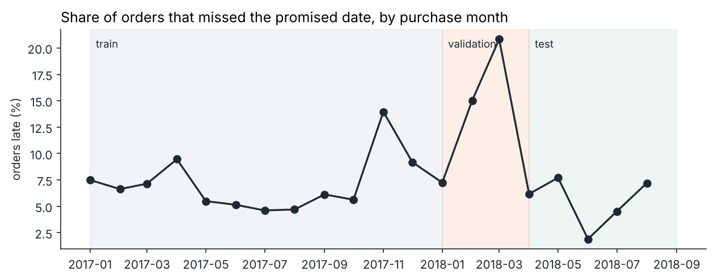
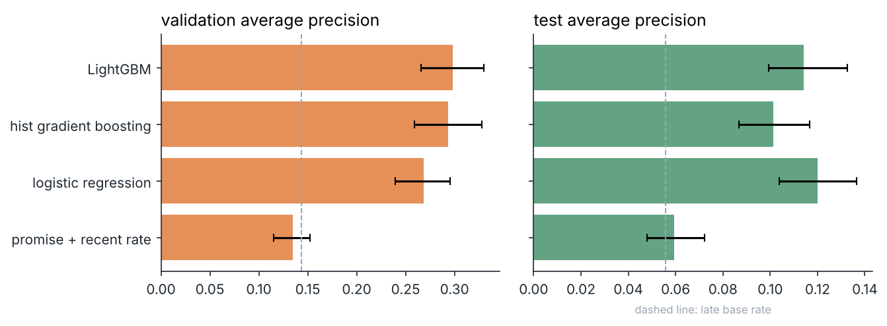
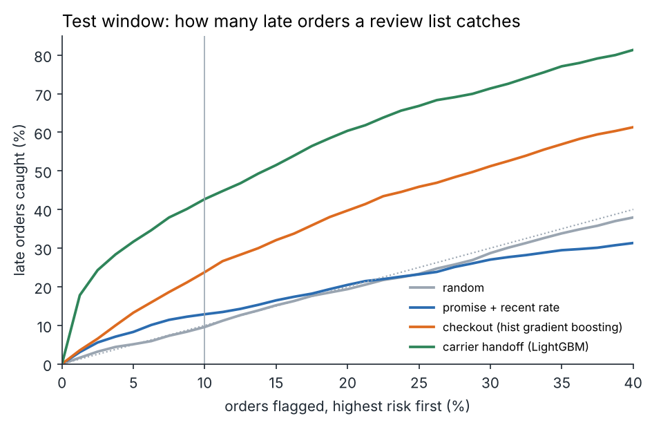
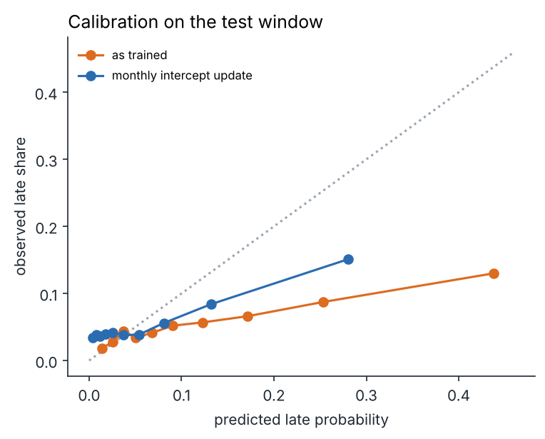
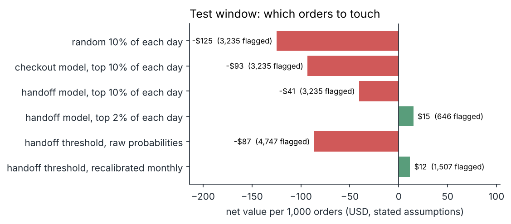
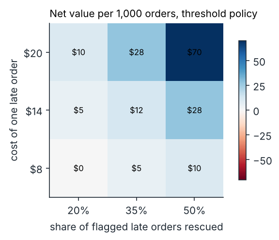
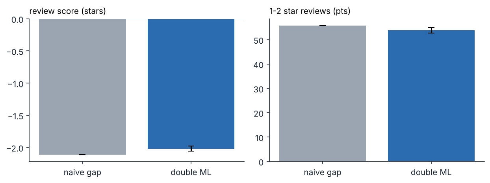
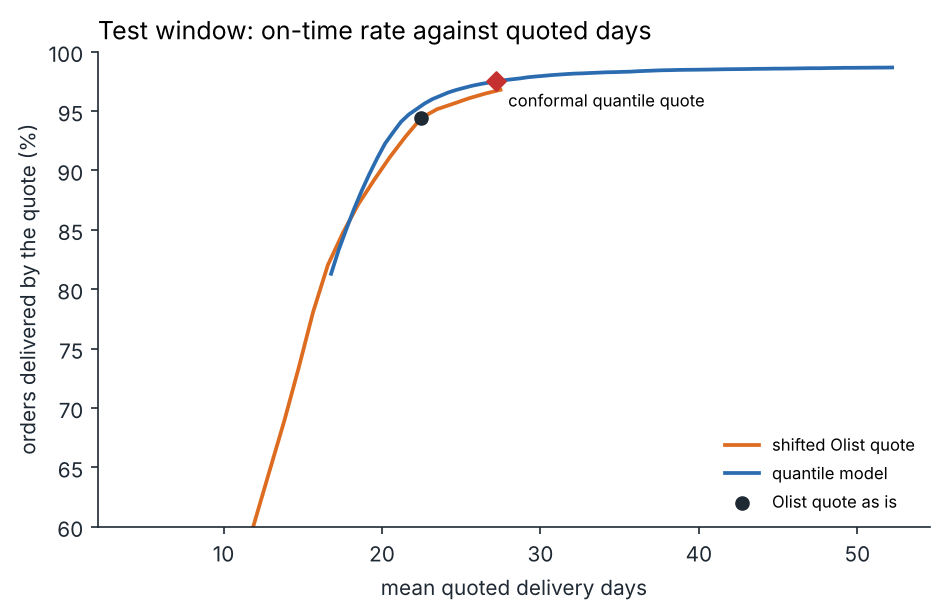
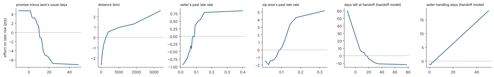
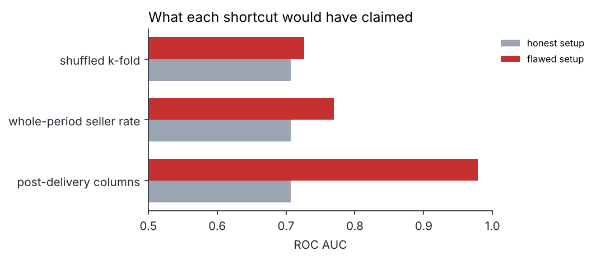

# promiseline

[](https://github.com/ranjithguggilla/promiseline/actions/workflows/ci.yml)

Late-delivery risk for marketplace orders, scored at two moments: when the customer checks out, and when the seller hands the parcel to the carrier. Built and tested on the public Olist export (about 98k labelled Brazilian e-commerce orders from 2017 and 2018), validated strictly forward in time, with probabilities that are re-anchored every month because the late rate in this data swings from 2% to 21%.

I started this wanting a model that flags late orders at checkout. The more useful answer turned out to be about timing. At checkout the signal is thin (test ROC AUC 0.66). By carrier handoff it is much stronger (AUC 0.80, and the top 10% of orders holds 43% of the late ones), and the median late order still has 13.6 days left on its promise at that point. So the repo ships both scorers, says plainly which one is worth acting on, and shows that acting only pays when the probabilities are recalibrated.

## Results

All numbers below come from `outputs/metrics.json` after `promiseline run`. Training covers orders placed in 2017, validation is January to March 2018, and the test window is April to August 2018. Every model is refit on train plus validation before it touches the test window. Intervals are 95% bootstrap intervals that resample whole purchase days, because orders placed on the same day share carriers, weather and backlog.



The validation quarter is the worst stretch in the data (14.3% late, peaking at 20.8% for March purchases), while the test window runs at 5.6%. That gap shapes almost every result below.

### Checkout: which model, and how much signal

| model | valid AP | test AP [95% CI] | test AUC | late orders in top 10% |
|---|---|---|---|---|
| promise length + recent late rate | 0.135 | 0.059 [0.048, 0.072] | 0.471 | 12.7% |
| logistic regression | 0.269 | 0.120 [0.104, 0.136] | 0.707 | 24.6% |
| hist gradient boosting (shipped) | 0.294 | 0.101 [0.087, 0.117] | 0.655 | 23.3% |
| LightGBM | 0.298 | 0.114 [0.099, 0.133] | 0.678 | 24.4% |

Test base rate: 5.58% of 32,545 orders.



The selection rule is the one-standard-error rule on validation average precision: take the simplest model within one paired-bootstrap SE of the best. LightGBM scored best (0.298); histogram boosting was 0.004 behind with an SE of 0.006, so it was chosen. Logistic regression was 0.029 behind with an SE of 0.009, so it was ruled out.

On the test window logistic regression came out on top anyway. The trees learned the strike-heavy validation quarter a little too well. I kept the protocol's choice rather than swapping after seeing test results, because that swap is exactly the kind of quiet leak this project tries to avoid. The gap between them is small next to the intervals. Even so, the shipped checkout model beats the naive baseline by 0.042 AP [0.030, 0.056].

One thing surprised me. Olist's own promise length carries no ranking information about lateness at all (AUC 0.47). The quoted date is padded for everyone. It is not tuned to the risk of the route.

### Waiting for carrier handoff

| model at handoff | valid AP | test AP [95% CI] | test AUC | late orders in top 10% | precision in top 10% |
|---|---|---|---|---|---|
| logistic regression | 0.351 | 0.235 [0.212, 0.261] | 0.796 | 39.3% | 20.9% |
| hist gradient boosting | 0.384 | 0.316 [0.280, 0.356] | 0.791 | 42.6% | 22.6% |
| LightGBM (shipped) | 0.391 | 0.346 [0.309, 0.388] | 0.800 | 42.7% | 22.7% |

Here LightGBM won outright: the next simplest model was 0.0067 behind with an SE of 0.0053, so the one-SE rule kept LightGBM. On the same 32,453 test orders, handoff beats checkout by 0.248 AP (0.346 vs 0.098), with a paired interval of [0.206, 0.293]. The 92 test orders that never reached a carrier were all late. They are left out of this comparison and are easy to catch with a simple rule anyway.



### Calibration when the late rate moves

A model fit through March 2018 expects a world where 1 in 7 orders is late. In June only 1 in 50 was. To handle that, each month I shift the model's log-odds by one constant, chosen so the mean prediction matches the late rate of recent orders. I only use orders whose outcome was already known on the first day of that month: purchases 15 to 45 days old, with a resolved label.

| | ECE before | ECE after | log loss before | log loss after |
|---|---|---|---|---|
| checkout model | 0.074 | 0.034 | 0.249 | 0.223 |
| handoff model | 0.093 | 0.023 | 0.222 | 0.174 |



The update lags by design. August is the clearest miss: the window it learned from ran at 1.7% late, but August itself came in at 7.2%.

### What it is worth, and when it loses money

The money model assumes three things, all set in `config.py`. Touching an order (a seller nudge, a carrier check, a note to the customer) costs $1.50. It rescues 35% of the late orders it touches. An unrescued late order costs $14 in support time, goodwill vouchers and lost repeat margin. Under those assumptions an order is worth touching when its late probability is above 1.50 / (0.35 × 14) = 0.306.

| policy on the test window | orders flagged | late orders caught (of 1,724) | net per 1,000 orders |
|---|---|---|---|
| random 10% of each day | 3,235 | 163 | -$124.91 |
| checkout model, top 10% of each day | 3,235 | 373 | -$93.21 |
| handoff model, top 10% of each day | 3,235 | 722 | -$40.51 |
| handoff model, top 2% of each day | 646 | 297 | +$14.98 |
| handoff threshold, raw probabilities | 4,747 | 880 | -$86.54 |
| handoff threshold, recalibrated monthly | 1,507 | 538 | +$11.58 |



The fixed top-2% list made slightly more, but nothing in the training or validation data would have told me to pick 2%. Validation actually favoured 10%. The threshold policy picks its own list size each month, and it stays positive across all nine cells of the sensitivity grid: from +$0.04 per 1,000 orders in the most pessimistic cell up to +$70 in the most optimistic. The same threshold applied to uncalibrated probabilities loses $87 per 1,000 orders. That gap is the strongest argument in this repo for the recalibration step.



To be clear about scale: $11.58 per 1,000 orders is modest. The larger prize is the damage a late order does to the review, measured next.

### What a missed promise does to the review

Late orders differ from on-time ones before anything goes wrong: they travel further, ship from different sellers and land in different states. I estimated the effect of lateness with a partially linear double machine learning model (DoubleML, 5-fold cross-fitting, LightGBM for both nuisance models, all checkout features as confounders) on 97,170 reviewed orders.

| outcome | naive gap | double ML [95% CI] |
|---|---|---|
| review score (stars) | -2.11 | -2.02 [-2.05, -1.98] |
| share of 1-2 star reviews | +55.8 pts | +53.8 pts [+52.7, +54.9] |



Adjusting for confounders barely moves the estimate, which is informative in its own right. Who orders what, and from where, hardly explains why late orders get bad reviews. The delay itself does.

### Shorter promise dates?

The median order arrives 12.4 days before its quoted date, so cutting the quote looks like free conversion. I fit a LightGBM quantile model (alpha 0.9) of delivery days, conformalised it on the validation quarter to cover 92% of orders, and compared it with the cheapest alternative, which is Olist's quote moved by a whole number of days.

| quoting rule on the test window | mean quoted days | delivered by the quote |
|---|---|---|
| Olist quote as is | 22.48 | 94.4% |
| Olist quote shifted (validation allowed a 0-day cut) | 22.48 | 94.4% |
| conformal quantile quote (offset +4.48 days from validation) | 27.17 | 97.5% |



This part did not work, and I think the reason matters. The validation quarter was so slow that the calibration step padded the model's quotes, and even Olist's own quote only hit 85.7% there. In hindsight, at Olist's 94.4% test on-time rate, the best the quantile model could have done is 21.70 mean days, a saving of 0.78 days. The padding is what buys the reliability. I would not ship quote changes from this data.

### Explanations

Accumulated local effects (PyALE) for the shipped models. I used ALE rather than partial dependence because distance, promise length and lane history are strongly correlated.



At checkout the biggest lever is slack: how much longer the promise is than this lane's recent average. Orders whose promise falls short of the lane's usual time carry about 5 points more risk, while very generous promises carry about 7 points less. At handoff, the days left on the promise dominate everything else.

Each scored order also gets up to three plain-language reasons. I find them by swapping each input to a typical value and measuring how far the risk falls. The three riskiest test orders at handoff, all of which were in fact late:

- "the parcel reached the carrier 7.5 days after the promised date", "the seller took 25.9 days to hand over", "the seller missed its shipping deadline"
- "the parcel reached the carrier 12.6 days after the promised date", "the seller took 30.2 days to hand over", "the seller missed its shipping deadline"
- "the parcel reached the carrier 0.3 days after the promised date", "the seller took 19.6 days to hand over", "this seller has missed 18% of past promises"

### Ways this could have fooled me



| shortcut | honest test AUC | what the shortcut claims |
|---|---|---|
| keep post-delivery columns (review request date, review score) | 0.707 | 0.978 |
| seller late rate computed over the whole export, not as-of | 0.707 | 0.770 |
| shuffled 5-fold CV on the development window | 0.707 (AP 0.120) | 0.726 (AP 0.267) |

Shown for the logistic checkout model. The review request date is the sneakiest of the three. Olist sends the request on delivery, so the column holds the answer, and it sits in the same table as everything else.

## Architecture

```
 Olist CSVs (9 tables, pinned GitHub mirror)
            |
            v
   data.py  one row per order, late label + "label known at" time
            |   haversine distance between zip centroids
            v
 features.py / history.py
   checkout: promise, lane slack, as-of seller/lane/state/zip late rates,
             lane delivery days, volume windows      (sort + binary search)
   handoff:  handling days, approval lag, missed shipping limit, days left
            |
            v
   models.py  promise-only | logistic | hist GBM | LightGBM
              (all preprocessing inside sklearn pipelines,
               LightGBM tuned with TimeGapSplit and a 30-day gap)
            |
   evaluate.py  day-cluster bootstrap, paired one-SE choice
            |
     +------+-----------+------------------+-------------------+
     v                  v                  v                   v
 calibrate.py      economics.py        promise.py          causal.py
 monthly logit     threshold policy,   quantile model +    DoubleML effect
 shift from        fixed lists,        conformal offset    of lateness on
 matured labels    sensitivity grid    vs shifted quote    review score
     |                  |                  |                   |
     +------------------+---------+--------+-------------------+
                                  v
         audit.py, explain.py (ALE + swap-to-typical reasons)
                                  v
          outputs/metrics.json, outputs/bundle.joblib, assets/*.png
                                  v
              score.py  ->  app.py (Gradio)
```

## Installation

```bash
git clone https://github.com/ranjithguggilla/promiseline.git
cd promiseline
python -m venv .venv && source .venv/bin/activate
pip install -r requirements.txt
pip install -e . --no-deps
```

Python 3.12 or newer. The pinned versions in `requirements.txt` are the ones every number here was produced with.

## Usage

1. Download the data (about 125 MB into `data/raw/`, which git ignores):

   ```bash
   promiseline fetch
   ```

2. Train, evaluate and write every table and chart (about 100 seconds on a 2-core machine):

   ```bash
   promiseline run
   ```

   `promiseline run --quick` uses a one-point LightGBM grid and lighter DoubleML learners for smoke runs.

3. Open the scoring app:

   ```bash
   promiseline app --port 7860
   ```

   Pick a decision point, set the route, promise and seller history, and the app returns the recalibrated risk, a band (normal, elevated, high) and the main reasons.

4. Score from Python:

   ```python
   import joblib
   from promiseline.score import score_order

   bundle = joblib.load("outputs/bundle.joblib")
   score_order(bundle, {"customer_state": "MA", "seller_state": "SP", "distance_km": 2500,
                        "promise_days": 14, "route_mean_days": 20, "route_recent_days": 20,
                        "handling_days": 12, "missed_ship_limit": 1}, stage="handoff")
   ```

   Any field you leave out takes the value of a typical order from the training window.

## Configuration

Everything tunable lives in `src/promiseline/config.py`:

| setting | default | meaning |
|---|---|---|
| `Splits.valid_start`, `test_start`, `test_end` | 2018-01-01, 2018-04-01, 2018-09-01 | forward-in-time windows on purchase date |
| `Splits.snapshot` | 2018-10-17 17:30 | export time; undelivered orders past their promise count as late |
| `CostAssumptions.late_order_cost` | 14.0 | USD cost of one late order |
| `CostAssumptions.action_cost` | 1.5 | USD cost of touching one order |
| `CostAssumptions.action_efficacy` | 0.35 | share of touched late orders that get rescued |
| `SOURCE_COMMIT` | `63401c2` | pinned commit of the data mirror |

`PROMISELINE_ROOT` overrides where `data/`, `outputs/` and `assets/` live. The LightGBM grid and the 92% quote target sit at the top of `pipeline.py`.

## Output structure

```
outputs/
  metrics.json           every number quoted in this README
  feature_inventory.csv  each column and the moment it becomes known
  bundle.joblib          both fitted models, reference order, monthly shifts, band cut-offs
assets/
  monthly_late_rate.png  checkout_models.png  capture_curves.png  calibration.png
  policies.png  economics_sensitivity.png  review_impact.png  promise_tradeoff.png
  ale.png  audits.png
```

## Project structure

```
src/promiseline/
  config.py      paths, split dates, cost assumptions
  fetch.py       pinned shallow fetch of the data mirror
  data.py        table loading, labels, order-level join, distances
  history.py     as-of sums, counts and windows via sort + searchsorted
  features.py    checkout and handoff features
  models.py      candidate pipelines, TimeGapSplit tuning
  evaluate.py    metrics, day bootstrap, one-SE rule
  calibrate.py   monthly intercept update from matured labels
  economics.py   fixed lists, threshold policy, sensitivity
  promise.py     quantile quotes, conformal offset, shifted quote
  causal.py      DoubleML effect on reviews
  audit.py       leakage and validation-design checks
  explain.py     ALE curves and per-order reasons
  score.py       score one order from a dict
  plots.py       charts
  pipeline.py    the end-to-end run
  app.py         Gradio front end
  cli.py         promiseline fetch | run | app
tests/           35 tests on a synthetic Olist-shaped export
data/README.md   source and licence notes
```

## Technical details

The label. An order is late when it arrives on a calendar day after the promised date, or when it never arrived and the promise expired before the export. That covers 1,721 orders, mostly stuck in "shipped". Cancelled and unavailable orders are dropped. Each label also records when it became knowable: on-time orders at delivery, late ones on the morning after the promise.

As-of history without loops. Seller, lane, state and zip-area late rates use only outcomes known before the order was placed. Events and queries are mapped to a composite integer (group code, seconds), sorted once, and counted with `np.searchsorted` plus a cumulative sum, so the whole table takes O((n + m) log n). Rates are shrunk toward the platform's own as-of rate with a pseudo-count of 20. A test rewrites every outcome after a cut-off and checks that no earlier feature changes.

Distances come from median coordinates per 5-digit zip prefix in the geolocation table, after dropping points outside Brazil's bounding box (a few sit in Europe). Unknown prefixes fall back to the state centroid, and distances use the vectorised `haversine` package.

Imputation, scaling and one-hot or ordinal encoding (rare categories pooled) all sit inside each sklearn pipeline. LightGBM hyperparameters come from scikit-lego's `TimeGapSplit` inside the training year, using 60-day folds and a 30-day gap so labels can mature.

With 5.6% positives I compare models on average precision and capture rather than accuracy, and I handle the decision threshold through costs instead of resampling, so the probabilities stay usable.

The causal estimate is `DoubleMLPLR` with a LightGBM regressor and classifier as nuisance learners, 5 folds and one repetition. Confounders are the numeric checkout features plus one-hot states, payment type and category (levels with at least 200 orders).

## Testing

```bash
ruff check .
pytest
```

The 35 tests run against a synthetic export built in `tests/conftest.py`, so they never touch the network. They cover:

- the as-of aggregates against a brute-force loop;
- the label rules, including same-day arrivals, never-arrived orders, cancellations and unexpired orders;
- the no-future-information guarantee on features;
- the one-SE rule, the paired day bootstrap, intercept shifting and matured windows;
- the threshold economics, conformal coverage, every candidate model handling unseen categories, the scoring function at both stages, and the Gradio app build.

CI runs lint and tests on every push and pull request. On `main` it also downloads the data, runs the full pipeline and uploads `outputs/` and `assets/` as a build artifact.

## Dataset

Olist, "Brazilian E-Commerce Public Dataset by Olist", Kaggle, CC BY-NC-SA 4.0: https://www.kaggle.com/datasets/olistbr/brazilian-ecommerce. Files are fetched from the public mirror https://github.com/tunguyenn99/ecommerce-data-modeling at commit `63401c2739ae42dd9bbfa7e20227fe7b7de725a3`. The data is not redistributed here.

## License

MIT, see [LICENSE](LICENSE). The licence covers the code only; the dataset keeps its own terms.
